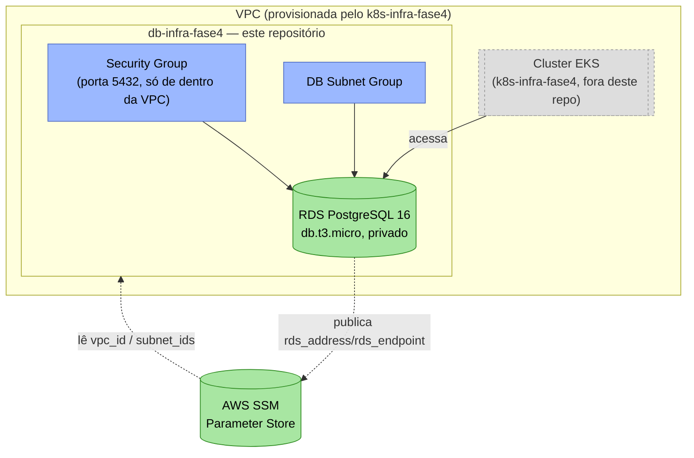

# db-infra-fase4

Infraestrutura do banco de dados relacional (Terraform) do projeto **Oficina Mecânica** — Fase 4 do Tech Challenge FIAP.

Provisiona a instância RDS PostgreSQL usada pelo `os-service` e pelo `billing-service`, e cria **um usuário e um conjunto de bancos isolados para cada serviço**: um serviço não consegue conectar nos bancos do outro. O `execution-service` usa MongoDB, provisionado pelo `k8s-infra-fase4`.

A visão geral da Fase 4 — arquitetura, Saga e os sete repositórios — está no README do [`os-service`](https://github.com/FIAP-15SOAT-GabrielHelton/os-service#arquitetura) e na [RFC-005](https://github.com/FIAP-15SOAT-GabrielHelton/os-service/blob/main/docs/fase4/RFC-005-microsservicos-e-saga.md). A escolha do PostgreSQL vem da Fase 3 e está justificada na [RFC-003](https://github.com/FIAP-15SOAT-GabrielHelton/os-service/blob/main/docs/fase3/RFC-003-escolha-do-banco-e-modelo.md).

| Repositório | Responsabilidade |
| :--- | :--- |
| [`os-service`](https://github.com/FIAP-15SOAT-GabrielHelton/os-service) | Microsserviço de Ordens de Serviço (cadastros, estoque e ciclo de vida da OS) — PostgreSQL |
| [`billing-service`](https://github.com/FIAP-15SOAT-GabrielHelton/billing-service) | Microsserviço de orçamento e pagamento (Mercado Pago) — PostgreSQL |
| [`execution-service`](https://github.com/FIAP-15SOAT-GabrielHelton/execution-service) | Microsserviço de fila e andamento da execução — MongoDB |
| [`k8s-infra-fase4`](https://github.com/FIAP-15SOAT-GabrielHelton/k8s-infra-fase4) | VPC, EKS, RabbitMQ, MongoDB e New Relic |
| `db-infra-fase4` (este repo) | RDS PostgreSQL, com usuário e bancos isolados por serviço |
| [`auth-serverless-fase4`](https://github.com/FIAP-15SOAT-GabrielHelton/auth-serverless-fase4) | API Gateway e Lambdas de autenticação/RBAC |
| [`deploy-orchestrator-fase4`](https://github.com/FIAP-15SOAT-GabrielHelton/deploy-orchestrator-fase4) | Deploy e destroy de todos os repositórios, em sequência |

## Tecnologias utilizadas

| Categoria | Tecnologia |
| :--- | :--- |
| IaC | Terraform (`hashicorp/aws` ~> 5.0) |
| Nuvem | AWS RDS (PostgreSQL 16), Security Group, DB Subnet Group |
| Isolamento | Job Kubernetes com `psql` (`k8s/`): cria usuários e bancos por serviço |
| CI/CD | GitHub Actions (`pull_request` para validação, `workflow_dispatch` para deploy/destroy) |
| Backend do state | S3 (bucket compartilhado com os demais repositórios, key própria) |

## Arquitetura



- **Security Group** (`infra/rds.tf`): libera PostgreSQL (`5432`) só de dentro da VPC (lida via SSM, publicada pelo `k8s-infra-fase4`) — o RDS nunca é público.
- **DB Subnet Group**: usa as subnets públicas do `k8s-infra-fase4` (o RDS em si não é acessível de fora, apesar de estar em subnet pública — controlado pelo Security Group e por `publicly_accessible = false`).
- **Instância RDS**: PostgreSQL 16, `db.t3.micro`, 20-100 GB (autoscaling de storage).

## Isolamento entre os serviços

O desafio exige que nenhum serviço acesse o banco de outro. Os dois serviços dividem a instância para caber na AWS Academy, mas o isolamento é garantido pelo próprio PostgreSQL:

| Serviço | Usuário | Bancos |
| :--- | :--- | :--- |
| `os-service` | `os_service` | `oficina_mecanica_production` e os auxiliares `_cache`, `_queue`, `_cable` |
| `billing-service` | `billing_service` | `billing_service_production` e os auxiliares `_cache`, `_queue`, `_cable` |

O script [`k8s/bootstrap.sql`](k8s/bootstrap.sql) cria cada usuário com senha própria, torna-o dono dos seus bancos e executa `REVOKE CONNECT ... FROM PUBLIC` em cada um. Resultado: `os_service` não conecta nos bancos do Billing, e vice-versa. O usuário master (`postgres`) fica só com este repositório; nenhum serviço o conhece.

Como o RDS é privado, o script roda de dentro do cluster, como um Job ([`k8s/db-bootstrap-job.yaml`](k8s/db-bootstrap-job.yaml)). É idempotente: pode rodar a cada deploy.

## Dependências

Lê do SSM Parameter Store (publicados pelo `k8s-infra-fase4`, que precisa ser implantado primeiro):

| Parâmetro | Uso |
| :--- | :--- |
| `/oficina-mecanica/vpc_id` | VPC onde o RDS e seu Security Group são criados |
| `/oficina-mecanica/subnet_ids` | Subnets do DB Subnet Group |
| `/oficina-mecanica/eks_cluster_name` | Cluster onde o Job de isolamento roda |

## Parâmetros publicados

| Parâmetro | Valor | Consumido por |
| :--- | :--- | :--- |
| `/oficina-mecanica/rds_address` | Address do RDS PostgreSQL | `os-service`, `billing-service` |
| `/oficina-mecanica/rds_endpoint` | Endpoint (`host:porta`) do RDS PostgreSQL | `os-service`, `billing-service` |

## Execução local

Não há aplicação para "rodar" — apenas o Terraform pode ser validado localmente (o `apply` real exige uma sessão AWS Academy ativa e o `k8s-infra-fase4` já implantado):

```bash
cd infra/
terraform init -backend=false   # sem backend, só para validar/formatar localmente
terraform validate
terraform fmt -check
```

Para um `plan` completo (exige credenciais AWS válidas, o backend S3 e o `k8s-infra-fase4` já implantados):

```bash
terraform init \
  -backend-config="bucket=<nome-do-bucket-s3>" \
  -backend-config="key=oficina-mecanica/db-infra.tfstate" \
  -backend-config="region=us-east-1"

TF_VAR_db_password=<senha> terraform plan
```

## Configuração necessária

Secrets do repositório:

- `DB_PASSWORD` — senha do usuário master (`postgres`) do RDS.
- `OS_DB_PASSWORD` — senha do usuário `os_service` (a mesma configurada como `DB_PASSWORD` no repositório `os-service`).
- `BILLING_DB_PASSWORD` — senha do usuário `billing_service` (a mesma configurada como `DB_PASSWORD` no repositório `billing-service`).

## CI

Workflow `CI (Terraform Validate)` (`.github/workflows/ci.yml`), disparado em toda Pull Request contra `main` — é o status check (`Terraform fmt & validate`) exigido pela proteção da branch `main` antes do merge. Sem credenciais AWS disponíveis em PR (só chegam via input manual no `workflow_dispatch` de deploy), a validação cobre o que não depende de nuvem real:

1. **Terraform Format Check** (`terraform fmt -check -recursive`).
2. **Terraform Init sem backend** (`terraform init -backend=false`) — baixa os providers só para validação sintática, sem acessar o bucket S3 remoto.
3. **Terraform Validate** (`terraform validate`) — sintaxe, tipos e referências internas.

Não roda `terraform plan` — exigiria as credenciais efêmeras da sessão AWS Academy, que só existem no deploy manual.

## Deploy

Workflow `CD Deploy (RDS PostgreSQL)` (`.github/workflows/cd_deploy.yml`, `workflow_dispatch`), disparado manualmente com as credenciais temporárias da sessão do AWS Academy. Passos do job `deploy`:

1. **Mask Sensitive Credentials** — mascara as credenciais AWS e as senhas dos bancos no log do Actions.
2. **Configure AWS Credentials** — autentica a sessão via `aws-actions/configure-aws-credentials`.
3. **Bootstrap S3 Backend** — reutiliza (ou cria, se ainda não existir) o bucket S3 compartilhado de state do Terraform entre os repositórios.
4. **Terraform Provisioning** — `terraform init` + `terraform apply -auto-approve`, provisionando o RDS PostgreSQL (lendo `vpc_id`/`subnet_ids` publicados pelo `k8s-infra-fase4` no SSM) e publicando `rds_address`/`rds_endpoint` no SSM para os serviços consumirem.
5. **Bootstrap Service Databases** — roda o Job de isolamento no cluster (usuários, bancos e `REVOKE CONNECT`) e apaga o Secret temporário com as senhas em seguida.

**Pré-requisito**: o `k8s-infra-fase4` precisa ter sido implantado antes (publica os parâmetros de rede e o cluster que este workflow usa).

**Ordem de deploy do projeto**: `k8s-infra-fase4` → `db-infra-fase4` → `os-service` → `billing-service` → `execution-service` → `auth-serverless-fase4` (ou use o [`deploy-orchestrator`](https://github.com/FIAP-15SOAT-GabrielHelton/deploy-orchestrator-fase4)).

## Destroy

Workflow `CD Destroy (RDS PostgreSQL)`. Deve rodar **depois** do destroy dos microsserviços e **antes** do destroy do `k8s-infra-fase4`.

## Documentação da API

Este repositório não expõe nenhuma API HTTP — é infraestrutura pura. A documentação das APIs (Swagger/OpenAPI) vive em cada microsserviço: [`os-service`](https://github.com/FIAP-15SOAT-GabrielHelton/os-service#documentação-da-api), [`billing-service`](https://github.com/FIAP-15SOAT-GabrielHelton/billing-service#documentação-da-api) e [`execution-service`](https://github.com/FIAP-15SOAT-GabrielHelton/execution-service#documentação-da-api).
